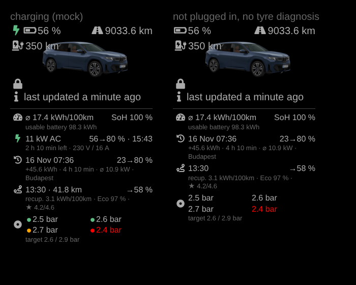

# MMM-BMWCarData
Magic Mirror Module to display data from BMW's Car Data API for your car(s).

**Warning**: very experimental at this moment, and development and testing is primarily focused on my specific use case (single european ICE car).

The module displays icons to show lock, charging and battery status, electric and combined range, and total kilometers driven. It also shows the time the module last received data from BMW's servers.

If you own several BMW cars, you can configure a module for each of them. The module configuration requires the vin number of the car to separate multiple module instances.

The module is heavily based on [MMM-MyBMW](https://github.com/Jargendas/MMM-MyBMW) by [Jargendas](https://github.com/Jargendas) which used the MyBMW API, which is not accessible anymore. It is mostly a re-write of the back end to support obtaining the data from BMW's CarData interface.

## Requirements

## Installation

Clone this repository in your modules folder, and install dependencies:

    cd ~/MagicMirror/modules
    git clone https://github.com/drdude684/MMM-BMWCarData.git
    cd MMM-BMWCarData
    npm install 

## Configuration

Obtain a BMW CardData client ID as per [BMW's instructions](https://bmw-cardata.bmwgroup.com/customer/public/api-documentation). Ensure 'request access to CarData API' is enabled for that client ID.
Go to the MagicMirror/config directory and edit the config.js file. Add the module to your modules array in your config.js.

Enter these details in the config.js for your MagicMirror installation:

        {
            module: "MMM-BMWCarData",
            position: "top_right",
            config: {
                clientId: "QQQQQQQQQQQQQQQQQQQQQQQ",
                vin: "XXXXXXXXXXXXXXXXX",
            }
        },

Now, on first start of the magic mirror you'll have to log in to a specifc bmw website using your connecteddrive credentials and provide a one time code to authorize the access. Details are provided in the module, but can also be found in the mm log. Note that you only have limited time to do this; typically, 5 minutes.

## Module configuration
The module has a few configuration options:

<table>
  <thead>
    <tr>
      <th>Option</th>
      <th>Description</th>
    </tr>
  </thead>
  <tbody>
    <tr>
      <td><code>clientId</code></td>
      <td>Your Client ID for the BMW CarData API, required.  <strong>Default: </strong><code>undefined</code></td>
    </tr>
    <tr>
      <td><code>vin</code></td>
      <td>Your car's VIN code, required.  <strong>Default: </strong><code>undefined</code></td>
    </tr>
    <tr>
      <td><code>refresh</code></td>
      <td>How often to refresh the data in minutes.    Be careful: BMW limits the amount of calls per account per day (to 50), so don't set this value too low.  <strong>Default: </strong><code>60</code></td>
    </tr>
    <tr>
      <td><code>vehicleOpacity</code></td>
      <td>The opacity of the car image. Between 0 and 1.  <strong>Default: </strong><code>0.75</code></td>
    </tr>
    <tr>
      <td><code>useUSUnits</code></td>
      <td>If true, miles instead of kilometres are shown for all range values. (implementation incomplete/untested/maybe not required)  <strong>Default: </strong><code>false</code></td>
    </tr>
    <tr>
      <td><code>showMileage</code></td>
      <td>Whether to show the mileage.   <strong>Default: </strong><code>true</code></td>
    </tr>
    <tr>
      <td><code>showElectricRange</code></td>
      <td>Whether to show the electric range. Will be hidden automatically if electric range is zero (i.e. when car is not electric). (implementation incomplete/untested)  <strong>Default: </strong><code>true</code></td>
    </tr>
    <tr>
      <td><code>showElectricPercentage</code></td>
      <td>Whether to show the battery charging also in percentages. Will be hidden automatically if electric range is zero (i.e. when car is not electric). (implementation incomplete/untested)  <strong>Default: </strong><code>true</code></td>
    </tr>
    <tr>
      <td><code>showFuelRange</code></td>
      <td>Whether to show the fuel range. Will be hidden automatically if fuel range is zero (i.e. when car is  electric).   <strong>Default: </strong><code>true</code></td>
    </tr>
    </tr>
    <tr>
      <td><code>fuelRangeWarning</code></td>
      <td>Fuel icon will be orange if remaining range is below this value (and above the fuelRangeCritical value).   <strong>Default: </strong><code>100</code></td>
    </tr>
    <tr>
      <td><code>fuelRangeCritical</code></td>
      <td>Fuel icon will be red if remaining range is below this value.   <strong>Default: </strong><code>50</code></td>
    </tr>
   <tr>
      <td><code>showLastUpdated</code></td>
      <td>Whether to show the info when the data was last updated.   <strong>Default: </strong><code>true</code></td>
        </tr>
    <tr>
      <td><code>lastUpdatedText</code></td>
      <td>The text to be shown before the last updated timestamp.   <strong>Default: </strong><code>last updated</code></td>
    </tr>
    <tr>
      <td><code>showConsumption</code></td>
      <td>Show average energy consumption, battery state of health and usable battery capacity.  <strong>Default: </strong><code>true</code></td>
    </tr>
    <tr>
      <td><code>showCharging</code></td>
      <td>While plugged in: charging power (kW), AC/DC, current → target SoC, estimated end time (ETA), remaining time, AC voltage/current.  <strong>Default: </strong><code>true</code></td>
    </tr>
    <tr>
      <td><code>showLastCharge</code></td>
      <td>Show the last charging session from BMW charging history (energy, SoC, duration, average power, location). Uses the <code>/chargingHistory</code> endpoint.  <strong>Default: </strong><code>true</code></td>
    </tr>
    <tr>
      <td><code>showTrip</code></td>
      <td>Show the last trip: end time, distance (derived from the mileage of consecutive trips), SoC at trip end, recuperation, Eco Pro share and driving-style stars.  <strong>Default: </strong><code>true</code></td>
    </tr>
    <tr>
      <td><code>showTyres</code></td>
      <td>Show tyre pressures per wheel (coloured when below target) with tyre temperatures and wear/defect dots from BMW Smart Maintenance tyre diagnosis.  <strong>Default: </strong><code>true</code></td>
    </tr>
    <tr>
      <td><code>tyrePressureUnit</code></td>
      <td><code>"bar"</code> or <code>"psi"</code>.  <strong>Default: </strong><code>"bar"</code></td>
    </tr>
    <tr>
      <td><code>tyreWarningDelta / tyreCriticalDelta</code></td>
      <td>Pressure below target (bar) at which the value turns orange / red.  <strong>Default: </strong><code>0.2 / 0.4</code></td>
    </tr>
    <tr>
      <td><code>chargingHistoryRefresh</code></td>
      <td>Minutes between charging-history calls. Results are cached in <code>bmw_cache.json</code> so restarts do not use extra API calls.  <strong>Default: </strong><code>360</code></td>
    </tr>
    <tr>
      <td><code>tyreDiagnosisRefresh</code></td>
      <td>Minutes between tyre-diagnosis calls (cached like above).  <strong>Default: </strong><code>720</code></td>
    </tr>
    <tr>
      <td><code>scope</code></td>
      <td>OAuth scopes requested at login. Add <code>cardata:streaming:read</code> only if "CarData Stream" is enabled for your client ID.  <strong>Default: </strong><code>"authenticate_user openid cardata:api:read"</code></td>
    </tr>
  </tbody>
</table>

### Extended EV telemetry panel

Shown below "last updated". Every row is hidden automatically when the car doesn't report that data.
With the default settings the module uses about 30 of the 50 daily CarData API calls (24 telematic refreshes + 4 charging-history + 2 tyre-diagnosis calls).
The data container is re-created automatically when the list of requested data points changes (its name contains a hash of the list).
Not available via the CarData API: battery temperature, and an explicit charging end time (the ETA is computed from the remaining charging time).

## Changelog

**2026-11-18** Extended EV telemetry panel: average consumption, battery health/capacity, live charging (kW, AC/DC, target, ETA), last charging session (charging history endpoint), last trip, tyre pressures/temperatures and tyre wear (tyre diagnosis endpoint). Automatic container migration and on-disk cache for rate-limited endpoints. 
**2026-11-17** EV support (tested target: BMW iX3 Neue Klasse): battery SoC, charging/plug status and EV descriptors; per-login PKCE; null-safe parsing; compatibility with older MagicMirror (2.9.x / Node 10, falls back to node-fetch and console logging). For electric cars set <code>showFuelRange: false</code>. Login now requests only <code>cardata:api:read</code> by default (optional <code>scope</code> config to override), so a client ID without "CarData Stream" enabled works. 
**2024-12-24** Pushed first version which fully works for my car. 
**2024-12-22** Forked from MMM-MyBMW and migrated to BMW CarData API. 
